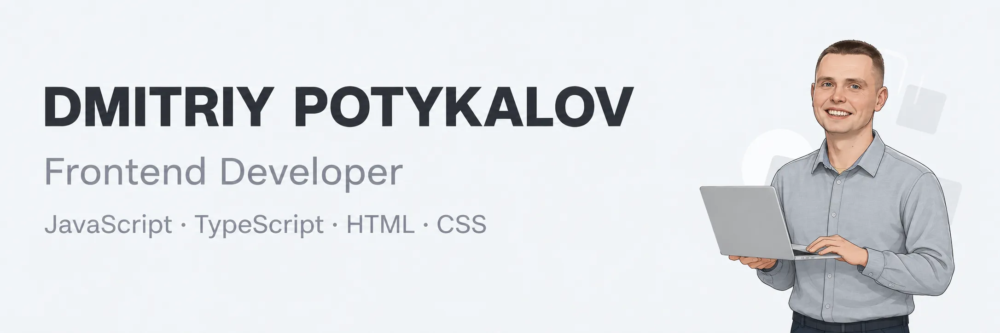

# Привет, я Дмитрий! 👋🏻 👨🏼‍💻

Ищу свою первую работу в качестве **фронтенд-разработчика**.
 
Рассматриваю офисный, удалённый и гибридный форматы. Готов к релокации.

[Резюме](https://drive.google.com/open?id=1-FthWK2FrCPop39JiLnkouS1WSrIpZer&usp=drive_fs) · [Контакты](#contacts)

## Технологии и инструменты

 

 

 

**Проекты:** [Retro Game](#retro-game--пошаговая-браузерная-игра) · [Financial Management App](#financial-management-app--учёт-личных-финансов) · [NOEMI](#noemi--адаптивная-вёрстка-сайта) · [Неткоин](#неткоин--управление-внутренней-валютой) · [Крестики-нолики](#дополнительные-проекты) · [Виселица](#дополнительные-проекты)

 

## Основные проекты

Все проекты ниже выполнены в учебных целях.

### Retro Game — пошаговая браузерная игра

  

Браузерная игра на поле 8 × 8 с пошаговыми сражениями против компьютера, развитием персонажей и сохранением игрового прогресса.

На основе учебного шаблона реализовал игровую логику, поведение компьютерного противника, переходы между уровнями, сохранение состояния и дополнительные элементы интерфейса.

**Технологии:** JavaScript, ООП, DOM API, localStorage, Webpack, Jest.

**[Открыть игру](https://potykalov.github.io/retro-game/)** ·
[Исходный код и документация](https://github.com/potykalov/retro-game)

### Financial Management App — учёт личных финансов

  

SPA-приложение для управления счетами, доходами, расходами и историей транзакций.

На основе предоставленного интерфейса реализовал клиентскую JavaScript-логику: работу с формами, авторизацию, взаимодействие с серверным API и динамическое обновление финансовых данных.

**Технологии:** JavaScript, DOM API, XMLHttpRequest, REST API, ООП.

**[Открыть приложение](https://financial-management-app-d3nz.onrender.com/)** ·
[Исходный код и документация](https://github.com/potykalov/financial-management-app)

*Первый запуск демо на Render может занять некоторое время.*

### NOEMI — адаптивная вёрстка сайта

Адаптивная страница блога, свёрстанная по предоставленным дизайн-макетам для десктопа, планшета и смартфона.

Реализовал HTML-разметку, стилизацию и адаптацию интерфейса под различные размеры экрана.

**Технологии:** HTML5, CSS3, Flexbox, Media Queries.

**[Открыть сайт](https://potykalov.github.io/mq-diploma/)** ·
[Исходный код и документация](https://github.com/potykalov/mq-diploma)

### Неткоин — управление внутренней валютой

  

Веб-приложение для управления балансом, конвертации внутренней валюты и переводов между пользователями.

Связал предоставленные компоненты интерфейса с готовым API-клиентом, реализовал обработку пользовательских действий и обновление данных после выполнения операций.

**Технологии:** JavaScript, REST API, callback-функции, DOM.

**[Открыть приложение](https://netcoin-exchange.onrender.com/)** ·
[Исходный код и документация](https://github.com/potykalov/netcoin-exchange)

*Первый запуск демо на Render может занять некоторое время.*

## Дополнительные проекты

| Проект | Описание | Ссылки |
| --- | --- | --- |
| Крестики-нолики | Игра для двух игроков на JavaScript с обработкой ходов и определением победителя | [Демо](https://potykalov.github.io/tic-tac-toe-js/) · [Код](https://github.com/potykalov/tic-tac-toe-js) |
| Виселица | Браузерная игра с обработкой ввода, проверкой букв и определением результата | [Демо](https://potykalov.github.io/hangmanGame/) · [Код](https://github.com/potykalov/hangmanGame) |

## Обучение

Прохожу обучение в Нетологии по программе **«Фронтенд-разработчик: расширенный курс»**.

Начало обучения — ноябрь 2025 года. Планируемое завершение — март 2027 года.

С июня 2026 года на волонтёрской основе помогаю другим студентам Нетологии разбираться в HTML, CSS, адаптивной вёрстке и ошибках в коде.

## Контакты 

  &emsp;&emsp;

